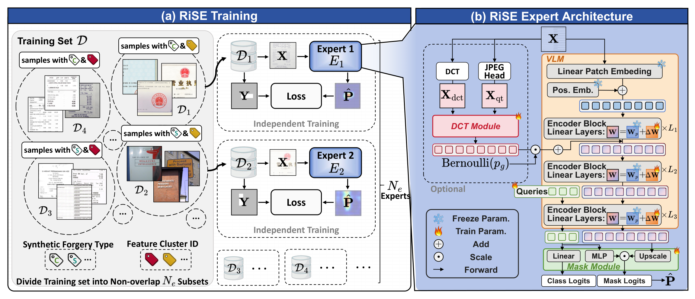
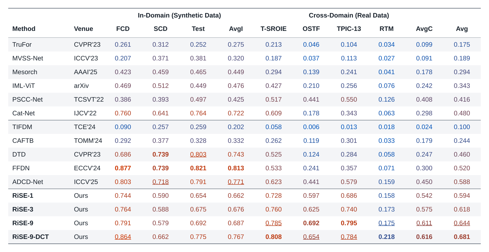

# RiSE

> RiSE preserves the principal subspace of a pretrained vision backbone and learns small residual experts for different forgery subsets. Latent Perturbation Confidence (LPC) selects an expert without ground-truth masks.

<p align="center"></p>

---

## 📊 ForensicHub Benchmark — Doc Protocol

Train on DocTamper and evaluate on **seven test sets**:

| Setting | Datasets | Evaluation input |
|---|---|---|
| In-domain | FCD, SCD, TestingSet | Exactly one JPEG encode using the official `record[-1]` |
| Cross-domain | T-SROIE, OSTF, TPIC-13, RTM | Original RGB JPEG; no resizing or recompression |

See [ForensicHub — Doc Protocol](https://github.com/scu-zjz/ForensicHub/issues/26).

> ForensicHub Doc Protocol F1 scores . **Bold** denotes the best score and <ins>underline</ins> the second best in each column. AvgI averages the three in-domain sets; AvgC averages the four cross-domain sets; Avg averages all seven.



## ⚙️ Environment Setup

```bash
git clone https://github.com/KahimWong/RiSE.git
cd RiSE
conda create -n rise python=3.10 -y
conda activate rise
pip install torch==2.4.0 torchvision==0.19.0 --index-url https://download.pytorch.org/whl/cu121
pip install -r requirements.txt
```

## 📂 Data Preparation

### 1. Download the datasets

- **In-domain:** [DocTamper](https://github.com/qcf-568/DocTamper), including the TrainingSet, TestingSet, FCD, and SCD LMDBs, official JPEG records, and forgery-type labels.
- **Cross-domain:** [Doc Protocol Data](https://huggingface.co/datasets/Jason37437/Doc-Protocol-Data), using the four tampered-image splits in `cutted_datasets_fakes.zip`.

Keep all datasets under one root:

```text
/path/to/datasets/
├── DocTamperV1/
│   ├── DocTamperV1-TrainingSet/
│   ├── DocTamperV1-TestingSet/
│   ├── DocTamperV1-FCD/
│   └── DocTamperV1-SCD/
└── cross/                         # T-SROIE, OSTF, TPIC-13, RTM
```

### 2. Generate evaluation manifests

```bash
# Repeat for FCD, SCD, and TestingSet with the corresponding official QF file.
python tools/prepare_data.py doctamper \
  --root /path/to/datasets --lmdb-dir DocTamperV1 --split FCD \
  --jpeg-records /path/to/pks/DocTamperV1-FCD_75.pk \
  --output data/FCD.jsonl

# Repeat for the four cross-domain sets with their image/mask path-list pickles.
python tools/prepare_data.py cross \
  --root /path/to/datasets \
  --paths /path/to/T-SROIE_test.pkl --output data/T-SROIE.jsonl
```

Each JSONL manifest contains one image record per line. Cross-domain path-list pickles must reference files inside your dataset root; update any old absolute paths before conversion. Training-manifest commands are in [Training](#-training).

### 3. Configure dataset paths

Copy `configs/data.example.json` to `configs/data.json`. Set `root` to `/path/to/datasets` and supply all seven manifest paths. Paths inside manifests are relative to `root`; manifest paths are relative to the config file.

The loader compresses each in-domain image **once at `record[-1]`** and reads cross-domain RGB JPEGs **without resizing or recompression**. DCT inputs come from the same JPEG bytes. Preserve the official sample order for reproducible first-N evaluations.

## 🧩 Models and Checkpoints

| Variant | Experts | Training partition | Config |
|---|---:|---|---|
| RiSE-1 | 1 | Entire training set | `configs/rise1.json` |
| RiSE-3 | 3 | GE / CM / SP synthesis types | `configs/rise3.json` |
| RiSE-9 | 9 | Three balanced clusters within each type | `configs/rise9.json` |
| RiSE-9-DCT | 9 | Same nine subsets, plus DCT fusion | `configs/rise9_dct.json` |

## 🚀 Training

### 1. Prepare expert assignments

**RiSE-1** uses all training images; **RiSE-3** uses GE=0, CM=1, SP=2:

```bash
python tools/prepare_data.py doctamper \
  --root /path/to/DocTamperV1 --split TrainingSet --num-experts 1 \
  --output data/train_rise1.jsonl

python tools/prepare_data.py doctamper \
  --root /path/to/DocTamperV1 --split TrainingSet --num-experts 3 \
  --forgery-types /path/to/DocTamperV1-TrainingSet.pk \
  --output data/train_rise3.jsonl
```

For **RiSE-9 / RiSE-9-DCT**, extract queries from a trained RiSE-1 checkpoint and form three balanced clusters within each forgery type:

```bash
python tools/extract_queries.py \
  --checkpoint checkpoints/rise1.pth --manifest data/train_rise1.jsonl \
  --data-root /path/to/DocTamperV1 \
  --forgery-types /path/to/DocTamperV1-TrainingSet.pk \
  --output outputs/training_queries.npz
python tools/partition_experts.py --embeddings outputs/training_queries.npz \
  --output data/expert_assignments.json
python tools/prepare_data.py doctamper \
  --root /path/to/DocTamperV1 --split TrainingSet --num-experts 9 \
  --assignments data/expert_assignments.json --output data/train_rise9.jsonl
```

### 2. Train

```bash
torchrun --standalone --nproc_per_node=4 train.py \
  --config configs/rise1.json --manifest data/train_rise1.jsonl \
  --data-root /path/to/DocTamperV1 --batch-size 4 --steps 10000 \
  --output outputs/rise1
```

Choose the matching config and manifest for each variant; both nine-expert variants use `train_rise9.jsonl`. Defaults: AdamW, learning rate `3e-4` → `1e-5`, weight decay `1e-4`. `--steps` counts optimizer updates; effective batch size is `batch-size × accumulation × GPU count` (16 above). Add `--resume /path/to/checkpoint.pth` to restore training state; sample order restarts.

## 🔎 Single-Image Inference

```bash
python infer.py --checkpoint checkpoints/rise9.pth --config configs/rise9.json \
  --image /path/to/image.jpg --output outputs/demo
```

Use a **512×512** input; DCT models require JPEG. No ground-truth mask is needed. Outputs: `mask.png`, `probability.npy`, and `metadata.json` with expert selection and confidence scores. Add `--mode parallel` to run all experts together; the default sequential mode uses less GPU memory.

## 📈 Seven-Set Evaluation

```bash
python evaluate.py --checkpoint checkpoints/rise9.pth --config configs/rise9.json \
  --data configs/data.json --output outputs/rise9_eval --gh-order 5
```

Evaluates all seven splits and saves per-image CSVs, metadata, dataset F1 scores, **AvgI**, **AvgC**, and **Avg**.

- `--limit 1000`: first 1,000 images per split, or all images if fewer.
- `--resume`: continue saved results with matching settings.
- `--mode parallel`: batch all experts on one GPU.
- `--num-shards N --shard-index I`: split evaluation across GPUs using separate output directories; combine per-image CSVs for full-set averages.

Quadrature order **5** follows the manuscript; use `--gh-order 7` to compare with the earlier order-7 runs. LPC noise variance is **0.5**. Settings are saved in the output metadata.

## 🗂️ Code Guide

```text
train.py / infer.py / evaluate.py  # Small, separate entry points
configs/                         # Explicit model and dataset settings
rise/models/model.py             # ViT segmenter, query decoder, optional DCT fusion
rise/models/experts.py           # Frozen principal weights + fixed residual experts
rise/models/dct.py               # JPEG coefficient / quantization-table encoder
rise/models/adf.py               # Gaussian moment propagation
rise/inference.py               # LPC selection and F1 metric
rise/data.py                    # LMDB/image input and exact JPEG protocols
tools/                           # Manifests, query extraction, balanced partitioning
```

## 🙏 Acknowledgements

Built on [EoMT](https://github.com/tue-mps/eomt), [DINOv3](https://github.com/facebookresearch/dinov3), [Effort](https://github.com/593Media/Effort), timm, Transformers, and efficientnet-pytorch.
